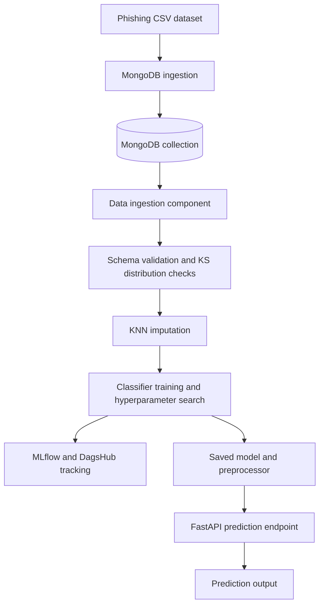

# Network Security — Phishing Detection ML Pipeline

An end-to-end machine learning project for classifying phishing-related network records. The repository is organized as a modular training workflow covering data ingestion, schema validation, preprocessing, model experimentation, experiment tracking, and API-based inference.

The aim is to make the workflow reproducible and maintainable beyond a standalone notebook: data is loaded from MongoDB, processed through reusable components, used to train and compare classification models, and exposed through a FastAPI prediction service.

## Project highlights

- **MongoDB ingestion:** retrieves phishing records from a configured MongoDB database and collection.
- **Modular ML workflow:** separates ingestion, validation, transformation, and model training into components.
- **Feature distribution checks:** applies the two-sample Kolmogorov–Smirnov (KS) test to compare feature distributions between the training and test splits and writes a YAML report.
- **Preprocessing:** uses a scikit-learn pipeline with KNN imputation to handle missing feature values.
- **Model experimentation:** compares Logistic Regression, Decision Tree, Random Forest, Gradient Boosting, and AdaBoost classifiers using cross-validation and hyperparameter search.
- **Experiment tracking:** logs F1-score, precision, recall, and model artifacts with MLflow and DagsHub.
- **Inference API:** provides CSV-based prediction through FastAPI.
- **Containerization and cloud workflow:** includes a Dockerfile and code for synchronizing artifacts to Amazon S3. GitHub Actions configuration is maintained in the repository.

## Architecture



## Pipeline stages

| Stage | What it does | Output |
|---|---|---|
| Data ingestion | Reads records from MongoDB and creates training and test datasets | Ingestion artifacts |
| Data validation | Checks the dataset columns against the YAML schema and compares train/test feature distributions using the KS two-sample test | Validation status and YAML drift report |
| Data transformation | Fits a KNN imputer on training features and applies the fitted transformer to train and test features | Transformed arrays and saved preprocessor |
| Model training | Searches hyperparameters with cross-validation, fits candidate classifiers, and selects a model using the configured classification scoring metric | Trained model and classification metrics |
| Experiment tracking | Logs F1-score, precision, recall, and model artifacts | MLflow/DagsHub runs |
| Inference | Loads the saved model and preprocessor, transforms uploaded CSV rows, and returns predictions | Prediction table and `prediction_output/output.csv` |

> **Drift-check scope:** the current workflow compares the training and test splits as a batch check. It is not a continuously running inference-time monitoring service.

## Technology stack

- **Language:** Python
- **Data processing:** Pandas, NumPy
- **Machine learning:** Scikit-learn, SciPy
- **Database:** MongoDB, PyMongo
- **Experiment tracking:** MLflow, DagsHub
- **API:** FastAPI, Uvicorn
- **Deployment tooling:** Docker, AWS S3 synchronization code, Amazon ECR workflow configuration

## Repository structure

```text
networksecurity/
├── .github/workflows/       # GitHub Actions workflow definitions
├── Network_Data/            # Source phishing dataset
├── data_schema/             # Dataset schema configuration
├── final_model/             # Saved model and preprocessing artifacts
├── networksecurity/
│   ├── cloud/                # Cloud storage synchronization
│   ├── components/           # Ingestion, validation, transformation, training
│   ├── constant/             # Pipeline constants
│   ├── entity/               # Configuration and artifact classes
│   ├── exception/            # Custom exception handling
│   ├── logging/              # Logging configuration
│   ├── pipeline/             # Training pipeline orchestration
│   └── utils/                # Data, model, and metric utilities
├── templates/                # HTML template for prediction output
├── app.py                    # FastAPI application
├── main.py                   # Component-by-component local training entry point
├── push_data.py              # Loads CSV records into MongoDB
├── Dockerfile
├── requirements.txt
└── setup.py
```

## Getting started

### 1. Clone the repository

```bash
git clone https://github.com/intilati/networksecurity.git
cd networksecurity
```

### 2. Create a virtual environment

The included Dockerfile uses Python 3.11.

**Windows (PowerShell)**

```powershell
py -3.11 -m venv .venv
.venv\Scripts\Activate.ps1
python -m pip install --upgrade pip
pip install -r requirements.txt
```

**Linux / macOS**

```bash
python3.11 -m venv .venv
source .venv/bin/activate
python -m pip install --upgrade pip
pip install -r requirements.txt
```

### 3. Configure environment variables

Create a `.env` file in the repository root:

```env
MONGO_DB_URL=your_mongodb_connection_string
MONGODB_URL_KEY=your_mongodb_connection_string
```

The current ingestion component reads `MONGO_DB_URL`, while the FastAPI application reads `MONGODB_URL_KEY`. Both should point to the same MongoDB connection string.

The project currently uses database `DastagirAI` and collection `NetworkData`. Do not commit your `.env` file or expose database credentials.

### 4. Load the dataset into MongoDB

Make sure the source CSV is available at `Network_Data/phisingData.csv`, then run:

```bash
python push_data.py
```

This script loads the CSV records into the configured MongoDB database and collection.

### 5. Run model training

The repository provides a component-by-component training entry point:

```bash
python main.py
```

It runs data ingestion, data validation, data transformation, and model training in sequence.

The FastAPI application also exposes a `GET /train` route that runs the orchestrated `TrainingPipeline`. That pipeline additionally attempts to synchronize artifacts and saved models to the configured S3 bucket; this requires valid AWS credentials and bucket access.

### 6. Start the prediction API

```bash
python app.py
```

The API starts at `http://127.0.0.1:8000`. Open the interactive API documentation at:

```text
http://127.0.0.1:8000/docs
```

| Method | Route | Purpose |
|---|---|---|
| `GET` | `/` | Redirects to the API documentation |
| `GET` | `/train` | Runs the orchestrated training pipeline |
| `POST` | `/predict` | Accepts a CSV upload and returns an HTML prediction table |

The `/predict` endpoint expects a CSV containing the input feature columns defined by the project schema. The saved model and preprocessor must be present under `final_model/`.

Example request:

```bash
curl -X POST "http://127.0.0.1:8000/predict" \
  -F "file=@sample.csv"
```

The prediction endpoint also writes the result to `prediction_output/output.csv`.

## Docker

Build the image from the repository root:

```bash
docker build -t networksecurity:latest .
```

Run the container:

```bash
docker run --rm -p 8000:8000 --env-file .env networksecurity:latest
```

The Dockerfile installs the dependencies and launches the FastAPI application with `python3 app.py`.

## Experiment tracking and cloud artifacts

The model-training component initializes the DagsHub repository for MLflow tracking and logs F1-score, precision, recall, and model artifacts. The orchestrated training pipeline contains AWS S3 synchronization for pipeline artifacts and saved models.

S3 synchronization requires AWS CLI credentials and access to the bucket configured in the project. Review the GitHub Actions workflow definitions and configure the necessary repository secrets before relying on automated image publishing.

## Reproducibility and scope notes

- MongoDB must be reachable and the source dataset must be available before running ingestion.
- The input dataset should match the feature names and target column defined in `data_schema/schema.yaml`.
- The KS report compares training and test distributions during the batch training workflow; it does not implement live drift monitoring.
- Classifier model selection uses F1-score rather than regression (R^2). Metrics should be reported from an actual completed run; no performance figures are claimed in this README.
- The project serializes Python model artifacts with pickle. Only load artifacts from sources you trust.

## License

See [LICENSE](LICENSE) if a license file is present in the repository.

## Author

**Dastagir Wasim Sheikh**

- GitHub: [@intilati](https://github.com/intilati)
